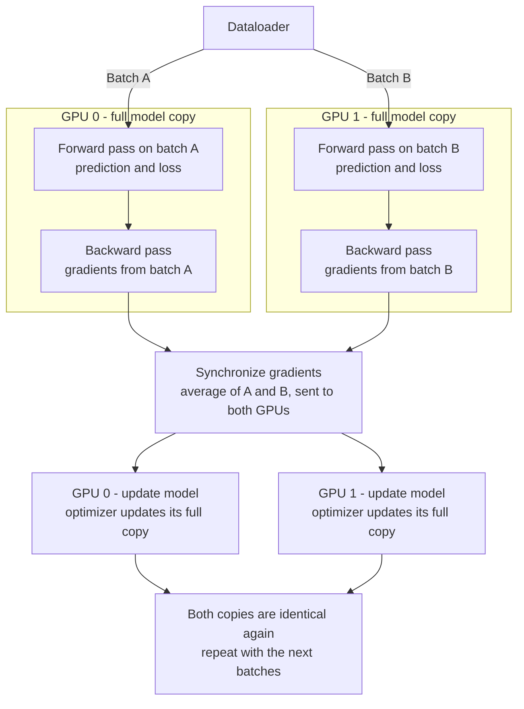
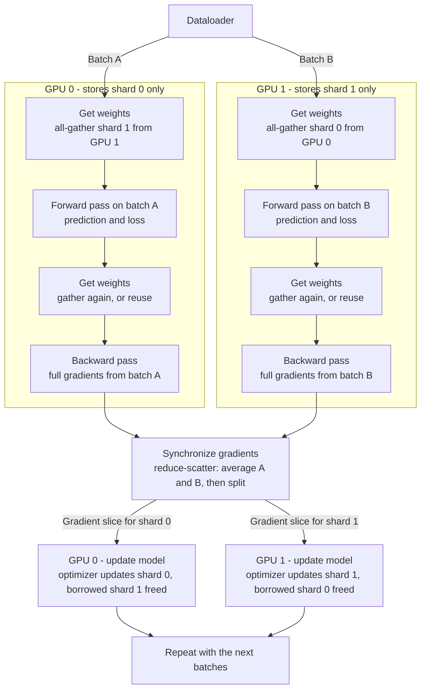

# Lesson 0: Course Introduction

## Core Idea
- LLMs let developers build AI apps in **days or weeks instead of months**.
- Generative AI is a **general-purpose technology**, like electricity or deep learning, and is useful across many industries.
- There is high demand and a shortage of people who can build LLM applications.

## Main Framework
**Generative AI Project Lifecycle:**
Scope the problem → Select a model → Adapt/optimize → Deploy and integrate

## Key Terms
- **Transformer**: the architecture behind LLMs
- **In-context learning**: guiding the model with examples in the prompt
- **Prompt engineering**: designing inputs for better outputs
- **Inference parameters**: settings that control how text is generated
- **Instruction fine-tuning**: training a pre-trained model for specific tasks
- **PEFT**: efficient fine-tuning that updates only a small part of the model
- **RLHF**: aligning the model with human preferences, making it more helpful and less harmful


# Lesson 1: Week 1 Introduction

## What This Lecture Discusses
An overview of Week 1's two main topics:
1. **Transformer architecture**: how it works and why it became so successful.
2. **Generative AI Project Lifecycle**: how to plan and build a GenAI project.

## Core Idea
- **Transformers** come from the 2017 paper *"Attention Is All You Need"* and are still state of the art.
- **Why they took off:** attention runs **massively in parallel**, which suits GPUs and lets models scale.
- Transformers also power **vision** and other modalities, not just text.
- **Model size depends on the use case:**
  - **Large (100B+ parameters):** broad general knowledge across many tasks.
  - **Small (1–30B or under 1B):** can do very well on a **single focused task**.

## Main Framework
**Generative AI Project Lifecycle:** key decisions:
1. Use an **off-the-shelf foundation model** or **pre-train your own**?
2. **Fine-tune** it on your specific data?
3. Choose the **right model** and **right size** for the task.

## Key Terms
- **Self-attention**: lets the model understand relationships between words
- **Multi-headed self-attention**: several attention mechanisms in parallel, each learning different patterns
- **Foundation model**: a large pre-trained model used as a starting point
- **Pre-training**: training a model from scratch on huge amounts of data
- **Fine-tuning**: further training a pre-trained model on your own data
- **Parameters**: the model's learned weights, which indicate its size
- **Vision transformer**: a transformer applied to images


# Lesson 2: Generative AI & LLMs

## What This Lecture Discusses
- What generative AI and LLMs are, and how they learn
- Foundation models and their size (parameters)
- How we interact with LLMs: **prompts, context window, completions, inference**

## Core Idea
- **Generative AI** is a **subset of machine learning**. It creates content that mimics human ability by learning **statistical patterns** from massive amounts of human-generated data.
- LLMs are trained on **trillions of words** over weeks or months, using huge compute power.
- Large models show **emergent properties**: beyond language, they can break down complex tasks, reason, and solve problems.
- **More parameters means more "memory"**, which allows more sophisticated tasks.
- You can **use models as-is or fine-tune them**, so there's no need to train from scratch.
- **The new way of interacting:** instead of code with formal syntax, you give LLMs **natural-language instructions**.
- GenAI covers many modalities (image, video, audio, speech), but this course focuses on **text (natural language generation)**.
- The course lab model is **FLAN-T5**, an open-source model.

## Main Framework
**How an LLM interaction works:**
**Prompt** → passed to **LLM** → model **predicts next words** → **Completion**
*(This whole process is called **inference**.)*

## Key Terms
- **Generative AI**: ML that creates human-like content
- **Foundation / base model**: a large pre-trained model with billions of parameters
- **Parameters**: the model's "memory"; more parameters means more capability
- **Emergent properties**: abilities beyond basic language, such as reasoning and problem-solving
- **Prompt**: the text input you give the LLM
- **Context window**: the memory space available for the prompt (a few thousand words, varies by model)
- **Completion**: the model's output (original prompt + generated text)
- **Inference**: using the model to generate text


# Lesson 3: LLM Use Cases & Tasks

## What This Lecture Discusses
- LLMs can do much more than chat
- The different tasks LLMs can perform using **next-word prediction**
- How model **scale** affects language understanding

## Core Idea
- **Next-word prediction** is the base concept behind all LLM capabilities, not just chatbots.
- **LLMs can do many text tasks:**
  - **Essay writing** from a prompt
  - **Summarization**, for example summarizing a dialogue given in the prompt
  - **Translation** between languages (English → Spanish) or from **natural language to code** (e.g., "write Python to get the mean of each column")
  - **Information retrieval**, such as finding people and places in an article (**NER**)
  - **Augmenting LLMs** by connecting them to **external data sources and APIs**, which gives them knowledge they lack from pre-training and lets them interact with the real world *(Week 3)*
- **Bigger models (hundreds of millions → hundreds of billions of parameters) have better language understanding**, which helps them reason and solve tasks.
- **Smaller models can still do well** on specific, focused tasks when **fine-tuned** *(Week 2)*.
- The rapid progress of LLMs is mainly due to their **architecture (transformers)**.

## Main Framework
**Next-word prediction → many capabilities:**
Chat | Essay writing | Summarization | Translation | Code generation | Entity extraction | External data/API connection

**Model size trade-off:**
- **Large model** → broad, general language understanding
- **Small + fine-tuned model** → strong on a single focused task

## Key Terms
- **Next-word prediction**: the core mechanism behind LLM text generation
- **Summarization**: condensing text, such as a dialogue, into key points
- **Translation**: language to language, or natural language to code
- **Named Entity Recognition (NER)**: identifying people, places, and other entities in text; a type of word classification
- **Information retrieval**: extracting specific information from text
- **Augmenting LLMs**: connecting a model to external data or APIs to extend its knowledge and actions


# Lesson 4: Text Generation Before Transformers

## What This Lecture Discusses
- How older language models (**RNNs**) worked and why they were limited
- Why language is hard for machines (**ambiguity**)
- How the **transformer architecture (2017)** solved these problems

## Core Idea
- **Generative algorithms are not new.** Earlier models used **Recurrent Neural Networks (RNNs)**.
- **RNN limitations:**
  - Seeing only a few previous words leads to **poor predictions**.
  - To see more words, **compute and memory grow exponentially**.
  - Even when scaled, they **still couldn't see enough context** to predict well.
- **Good prediction needs context from the whole sentence, or even the whole document.**
- **Language is complex:**
  - **Homonyms**: one word, many meanings ("bank" as a river bank or a money bank)
  - **Syntactic ambiguity**: unclear sentence structure ("The teacher taught the student with the book." Who has the book?)
- **2017: "Attention Is All You Need"** (Google and University of Toronto) introduced the **transformer**, which changed everything.
- **Why transformers won:**
  1. **Scale efficiently** on multi-core **GPUs**
  2. **Process input in parallel**, which enables much **larger training datasets**
  3. **Learn to pay attention** to the **meaning of words**

## Main Framework
**RNN vs Transformer**

| | RNN | Transformer |
|---|---|---|
| Context | Only a few previous words | Whole sentence or document |
| Scaling | Compute/memory grow exponentially | Scales efficiently on GPUs |
| Processing | Sequential | Parallel |
| Understanding | Limited | Uses **attention** to understand meaning |

## Key Terms
- **RNN (Recurrent Neural Network)**: an older architecture that processes text sequentially; limited context
- **Next-word prediction**: predicting the next word from previous words
- **Homonym**: a word with multiple meanings
- **Syntactic ambiguity**: a sentence whose structure allows more than one meaning
- **Transformer**: the 2017 architecture behind modern LLMs
- **Attention**: the mechanism that lets the model focus on the meaning of and relationships between words
- **Parallel processing**: handling input data at the same time instead of one step after another


# Lesson 5: Transformer Architecture

## What This Lecture Discusses
- Why **self-attention** makes transformers powerful
- The high-level **structure of a transformer** (encoder + decoder)
- The **step-by-step flow of data** through a transformer: tokenization → embedding → positional encoding → self-attention → feed-forward → softmax

## Core Idea
- Transformers learn the **relevance and context of every word to every other word** in a sentence, not just neighboring words.
- **Attention weights** (learned during training) show how strongly each word relates to the others, no matter where they appear in the input.
- An **attention map** visualizes these weights. For example, "book" pays strong attention to "teacher" and "student".
- The transformer has two parts: an **encoder** and a **decoder**. They work together and share many similarities.
- **ML models work with numbers, not words**, so text must be converted to numbers first.
- **You must use the same tokenizer** for training and for generating text.
- **Embedding vectors encode meaning and context.** Words close together in embedding space are related, and the **angle** between vectors measures similarity.
- Since tokens are **processed in parallel**, **positional encoding** is needed to keep word order.
- **Multi-headed attention:** many attention heads (commonly **12–100**) learn **in parallel and independently**. Each learns a different aspect of language, such as people relationships, activities, or rhymes.
- **You don't decide** what each head learns. Heads start with **random weights** and learn on their own during training.
- The final output is a **probability for every token in the vocabulary**. The highest score is the most likely next token, but other selection methods exist *(covered later)*.

## Main Framework
**Transformer data flow (bottom → top):**
1. **Tokenization**: words → token IDs (numbers)
2. **Embedding layer**: token IDs → vectors (meaning and context)
3. **Positional encoding**: added to the embeddings to keep word order
4. **Self-attention layer (multi-headed)**: learns relationships between all tokens
5. **Feed-forward network**: processes each token's vector further (inside every layer)
6. **Linear layer → logits**: one raw score per vocabulary token
7. **Softmax layer**: converts logits to **probabilities** → predicts the next token

> **Note:** The lecture said the feed-forward network produces the logits. In reality, a **final linear layer** after the last decoder layer produces them.

## Where Each Step Happens

| Step | Encoder | Decoder |
|---|---|---|
| Embedding + positional encoding | ✅ | ✅ |
| Self-attention | ✅ | ✅ (**masked**) |
| Cross-attention | ❌ | ✅ (looks at the encoder output) |
| Feed-forward network | ✅ | ✅ |
| Linear + softmax | ❌ | ✅ (**only at the end**) |

- **Encoder** understands the input. It **runs once**, processing all tokens in parallel.
- **Decoder** generates the output. It **runs once per output token**, in a loop (**autoregressive**).

## Full Workflow: Input Text → Output Text
**Example:** "I love tea" → "J'aime le thé"

**Part 1: Prepare input**
1. **Tokenize:** "I love tea" → `[I] [love] [tea]` → token IDs
2. **Embed:** token IDs → vectors
3. **Add positional encoding:** keeps word order

**Part 2: Encoder (runs once)**

4. **Multi-headed self-attention:** each token attends to all other tokens
5. **Feed-forward network**
6. Steps 4–5 repeat **× N layers** → **encoder output** (one context vector per token, reused by the decoder)

**Part 3: Decoder (runs once per output token)**

7. **Input:** `<start>` + tokens generated so far → embedding + positional encoding
8. **Masked self-attention:** looks only at past tokens, never future ones
9. **Cross-attention:** looks at the encoder output
10. **Feed-forward network**
11. Steps 8–10 repeat **× N layers**

**Part 4: Predict**

12. **Linear layer → logits** (one score per vocabulary token)
13. **Softmax → probabilities**
14. **Select the next token** (highest probability or a sampling method)

**Part 5: Loop and output**

15. **Feed the token back** and repeat Steps 7–14: `<start>` → J' → aime → le → thé → `<end>`
16. **Detokenize:** token IDs → "J'aime le thé"

```
Text → Tokenize → Embed + Position
     → ENCODER [Self-Attention → FFN] × N   (once)
     → DECODER [Masked Self-Attn → Cross-Attn → FFN] × N   (per token)
     → Linear (logits) → Softmax → Pick token
     → Loop until <end> → Detokenize → Output Text
```

**Training vs inference:** during **training**, the decoder also runs in parallel because the correct output is known, and masking hides future tokens. The token-by-token loop happens only during **inference**.

## Single Model, Not Multiple Models
- **Embedding, encoder, decoder, and the final linear + softmax layers all belong to ONE model.** All their weights are **trained together** in one training process.
- The **tokenizer is not a neural network**. It's a rule-based tool plus a vocabulary file that **ships with the model** and must match it.
- Downloading a model (e.g., FLAN-T5 from Hugging Face) gives you **one set of model weights + tokenizer files**.

**Why the confusion about multiple models?**
- **Older NLP (Word2Vec):** embeddings were trained as a **separate model** and plugged in. Transformers learn embeddings **inside** the model.
- **RAG and vector search** use **separate embedding models** to create vectors for vector databases. That is a different use case from the embedding layer inside an LLM.

## Model Types: Not Every Model Has Both Encoder and Decoder

| Type | Has | Examples | Best for | Why |
|---|---|---|---|---|
| **Encoder-only** | Encoder | **BERT**, RoBERTa | Classification, sentiment analysis, NER | Sees the **whole input at once in both directions**, giving deep understanding; doesn't need to generate text |
| **Encoder-decoder** | Both | **T5, FLAN-T5**, BART | Translation, summarization | The input and output are **different sequences**: the encoder understands the input, and the decoder generates a new output |
| **Decoder-only** | Decoder | **GPT**, LLaMA, most modern LLMs | General text generation, chat | Predicts the **next token** from previous tokens; simple, **scales very well**, and handles almost any task as text generation |

> Most modern LLMs are **decoder-only**. With enough scale, next-token prediction alone can handle almost any task. The next lecture covers these model types in more detail.

## Key Terms
- **Self-attention**: learns how each word relates to every other word in the input
- **Attention weights**: learned values showing the importance of each word to the others
- **Attention map**: a diagram showing the attention weights between words
- **Encoder**: understands the input and runs once
- **Decoder**: generates output one token at a time
- **Tokenization**: converting words, or parts of words, into token IDs
- **Tokenizer**: performs tokenization; must be the same for training and generation; not a neural network
- **Embedding layer**: the first layer of the model; maps each token to a vector
- **Embedding vector**: the numeric representation of a token's meaning (512 dimensions in the original paper)
- **Word2Vec**: an earlier NLP algorithm that used separately trained embeddings
- **Positional encoding**: adds word-order information to the token vectors
- **Multi-headed self-attention**: multiple attention heads learning different language aspects in parallel
- **Masked self-attention**: decoder attention that cannot see future tokens
- **Cross-attention**: lets the decoder look at the encoder output
- **Feed-forward network**: a fully connected layer inside every encoder and decoder layer
- **Logits**: raw scores from the final linear layer, one per vocabulary token
- **Softmax**: normalizes logits into probabilities across the whole vocabulary
- **Autoregressive generation**: generating one token at a time, feeding each output back as input
- **Detokenization**: converting token IDs back into text
- **Encoder-only / decoder-only / encoder-decoder**: the three transformer model types


# Lesson 6: Generating Text with Transformers

## What This Lecture Discusses
- The **end-to-end prediction process** of a transformer, using a translation example
- How the **encoder and decoder work together** to generate output
- The **three transformer model types**: encoder-only, encoder-decoder, decoder-only

## Core Idea
- **Translation (sequence-to-sequence)** was the **original purpose** of the transformer.
- **Encoder:** turns the input into a **deep representation of its structure and meaning**.
- **Decoder:** uses the encoder's understanding to **generate new tokens in a loop** until a stop condition (the end-of-sequence token).
- The encoder output is **inserted into the middle of the decoder** to influence its attention (cross-attention).
- **How you pick a token from the softmax output affects how creative the text is** *(covered later this week)*.
- Encoder and decoder can be **split apart** to create different model types.
- **Decoder-only models are the most common today.** As they scale, they **generalize to most tasks**.
- **You don't need to memorize every architecture detail.** The goal is to understand the differences between models and be able to **read model documentation**.
- You interact with models through **natural language (prompts)**, not code. This is **prompt engineering** *(next lecture)*.

## Main Framework

### Encoder–Decoder Workflow
**Example:** French "J'aime l'apprentissage automatique" → English "I love machine learning"

**Encoder side (runs once)**
1. **Tokenize** the input with the **same tokenizer used in training**
2. **Embedding layer** → vectors
3. **Multi-headed attention layers**
4. **Feed-forward network** → **encoder output** (a deep representation of meaning and structure)
5. The encoder output is **sent into the middle of the decoder** (cross-attention)

**Decoder side (loops once per token)**

6. Add a **start-of-sequence token** to the decoder input
7. **Decoder self-attention** + encoder context
8. **Decoder feed-forward network**
9. **Softmax output layer** → **first token** ("I")
10. **Feed the token back** into the decoder input → predict the next token
11. Repeat until the **end-of-sequence token**
12. **Detokenize** → "I love machine learning"

```
Input → Tokenize → Embed → [Multi-head Attention → FFN] → Encoder Output
                                                              ↓
<start> → Decoder [Self-Attention + Encoder Context → FFN] → Softmax → Token
     ↑                                                                   ↓
     └──────────── feed token back (loop) ←──────────────────────────────┘
                     until <end> → Detokenize → Output Text
```

### Three Transformer Model Types

| Type | Input vs output | Use cases | Examples |
|---|---|---|---|
| **Encoder-only** | Input and output are the **same length** (without modification) | **Classification** (sentiment analysis) after adding extra layers; less common today | **BERT** |
| **Encoder-decoder** | Input and output can be **different lengths** | **Sequence-to-sequence** (translation, summarization); can be scaled for general text generation | **BART, T5** (used in the labs) |
| **Decoder-only** | Generates text from the input | **Most common today**; generalizes to most tasks as it scales | **GPT, BLOOM, Jurassic, LLaMA** |

## My Questions & Answers

### Q1: What is the decoder's input? Does it take encoder outputs one by one?
**No.**
- **Decoder input = only its own generated tokens**, starting with `<start>` and growing by one token each step.
- **Encoder output = the full original sentence, always available.** At **every step**, cross-attention looks at **all** encoder vectors together and focuses on the relevant part.

| Step | Decoder input | Looks at | Output |
|---|---|---|---|
| 1 | `<start>` | all encoder vectors | I |
| 2 | `<start> I` | all encoder vectors | love |
| 3 | `<start> I love` | all encoder vectors | machine |
| 4 | `<start> I love machine` | all encoder vectors | learning |
| 5 | `<start> I love machine learning` | all encoder vectors | `<end>` → stop |

> 💡 Like translating word by word: you keep looking at the **original sentence** and at **what you've written so far** to choose the next word.

### Q2: What does "inserted into the middle of the decoder" mean? Why the middle?
The encoder finishes **first**. Its output then enters **inside each decoder layer**:

```
Each decoder layer:
  ① Masked self-attention  → "What have I written so far?"
  ② Cross-attention        → "Which part of the input do I need now?"  ← encoder output enters HERE
  ③ Feed-forward           → combine and process
```

**Why the middle?** The decoder must first understand **its own progress** (①) before it can **search the input intelligently** (②).

> 💡 First reread your own translation, then look at the original page for what comes next.

### Q3: What does "× N layers" mean? Is N the encoder output length?
**No. N = the number of stacked layers**, fixed by the model design (original transformer: 6).

| Number | Meaning | Fixed? |
|---|---|---|
| **N** | Number of layers (model depth) | ✅ Fixed |
| **Input length** | Number of input tokens = number of encoder vectors | ❌ Varies |
| **Output length** | Number of generated tokens = number of decoder steps | ❌ Varies |

- In each step, data passes through **Layer 1 → 2 → … → N in order**, then softmax picks **one token**.
- **KV cache:** real models cache old tokens' results, so each step processes **only the newest token**. This makes generation faster.

### Q4: How does the decoder know how many tokens to generate? (e.g., 5 input vectors → 7 output tokens)
**It doesn't know in advance.** It decides step by step.
- **`<end>` is a normal vocabulary token.** At each step, softmax gives it a probability too.
- When `<end>` is predicted, **generation stops**.
- **It learns this from training.** Every target output ends with `<end>` (e.g., "I love tea `<end>`"), so the model learns to stop once the full meaning is expressed.
- A **safety limit** (`max_new_tokens`) stops generation if `<end>` never comes.

> 💡 **Input length ≠ output length.** Generation stops at `<end>` (or the max limit), not when the encoder vectors run out.

## Key Terms
- **Sequence-to-sequence task**: input sequence → output sequence (e.g., translation)
- **Deep representation**: the encoder's rich understanding of the input's meaning and structure
- **Start-of-sequence token**: a special token that triggers the decoder to begin generating
- **End-of-sequence token**: a special token that tells the model to stop generating
- **Detokenization**: converting output tokens back into words
- **Cross-attention**: lets the decoder look at all encoder output vectors at every step
- **N layers**: the fixed number of stacked encoder or decoder layers
- **max_new_tokens**: a safety limit on how many tokens to generate
- **KV cache**: stores earlier tokens' results so only the new token is processed each step
- **Encoder-only model**: understanding and classification (BERT)
- **Encoder-decoder model**: input-to-output transformation (T5, BART)
- **Decoder-only model**: general text generation (GPT, LLaMA)
- **Prompt engineering**: interacting with a model through written natural-language prompts


# Lesson 7: Prompting & Prompt Engineering

## What This Lecture Discusses
- What **prompt engineering** is and why it's needed
- **In-context learning**: improving results by adding examples to the prompt
- **Zero-shot, one-shot, and few-shot inference**
- When to switch from prompting to **fine-tuning**
- How **model size** affects task performance

## Core Idea
- Models often **don't give the desired output on the first try**, so you revise the prompt several times. This is **prompt engineering**.
- A powerful strategy is to **include examples of the task inside the prompt**. This is **in-context learning**.
- **Large models** are good at **zero-shot** inference (no examples needed).
- **Smaller models** often fail at zero-shot (e.g., GPT-2 didn't follow the instruction) but improve with **one-shot or few-shot** examples.
- In few-shot prompts, **mix examples of different output classes** (e.g., one positive and one negative review) to help the model understand the task.
- **The context window is limited**, so you can only include a certain number of examples.
- **If 5–6 examples still don't work, try fine-tuning** instead *(Week 2)*.
- **Model scale matters:**
  - **Large models** can do many tasks, even ones they weren't specifically trained for.
  - **Small models** are good only at a few tasks, usually ones similar to their training.
- You may need to **try several models** to find the right one for your use case.

## Main Framework

### Prompt Structure (sentiment example)
```
Instruction:  Classify this review:
Context:      "I loved this movie!"
Output cue:   Sentiment: ______
```

### Zero-Shot vs One-Shot vs Few-Shot

| Type | Examples in prompt | Works best with |
|---|---|---|
| **Zero-shot** | 0: only the instruction and input | **Large models** |
| **One-shot** | 1 completed example + the actual input | Smaller models |
| **Few-shot** | 2+ examples (mixed classes) + the actual input | Even smaller models |

**One-shot example:**
```
Classify this review: I loved this movie!
Sentiment: Positive

Classify this review: I don't like this chair.
Sentiment: ______
```

### Decision Flow
```
Zero-shot → doesn't work? → One-shot → still not? → Few-shot
     → still not working after 5–6 examples? → Fine-tune the model
```

## Key Terms
- **Prompt**: the input text given to the model
- **Inference**: the act of generating text
- **Completion**: the output text
- **Context window**: the total text or memory available for the prompt; it limits how many examples you can add
- **Prompt engineering**: revising and improving the prompt to get the desired output
- **In-context learning (ICL)**: helping the model learn the task by putting examples or data in the prompt
- **Zero-shot inference**: no examples, only the instruction and input
- **One-shot inference**: one example included in the prompt
- **Few-shot inference**: multiple examples included in the prompt
- **Fine-tuning**: additional training on new data to make the model better at a specific task


# Lesson 8: Generative Configuration (Inference Parameters)

## What This Lecture Discusses
- **Configuration parameters** that control how the model picks the next word at inference time
- **Max new tokens, greedy decoding, random sampling, top-k, top-p, temperature**
- How these settings control **output length and creativity**

## Core Idea
- **Configuration parameters ≠ training parameters.** They are set **at inference time** and are not learned.
- They control two things: **output length** (max new tokens) and **creativity/randomness** (sampling, top-k, top-p, temperature).
- **Softmax output = a probability for every word in the vocabulary.** These settings decide **how to choose** from that list.
- **Greedy decoding** (default): always picks the highest-probability word. Good for short text, but it can **repeat words or phrases**.
- **Random sampling** adds variety but can become **too creative** and drift into nonsense.
- **Top-k and top-p limit random sampling** so the output stays **sensible** while keeping some variety.
- **Temperature changes the probability distribution itself.** Top-k and top-p only **filter** the choices.
- In Hugging Face, you must set **`do_sample=True`** to enable random sampling.

## Main Framework
```
Softmax probabilities
   → (Temperature reshapes the distribution)
   → (Top-k / Top-p filter the candidates)
   → Greedy (pick highest) OR Random sampling (pick by weight)
   → Next token
   → Repeat until <end> OR max_new_tokens reached
```

| Setting | Controls | Effect |
|---|---|---|
| **max_new_tokens** | Length | Maximum number of tokens to generate |
| **Greedy decoding** | Selection | Always the top word → predictable, may repeat |
| **Random sampling** | Selection | Weighted random pick → varied, may wander |
| **Top-k** | Candidate pool | Only the top **k** words |
| **Top-p** | Candidate pool | Top words until their probabilities **add up to p** |
| **Temperature** | Distribution shape | Low = focused; high = creative |

## Detailed Explanation with Examples
**Prompt:** "I love to eat ___"
**Softmax output (simplified):**

| Word | Probability |
|---|---|
| cake | 0.20 |
| donut | 0.10 |
| banana | 0.02 |
| apple | 0.01 |
| … (thousands more) | … |

### 1. max_new_tokens: limits length
- It's a **cap on how many times** the model runs the selection loop.
- `max_new_tokens = 100` → at most 100 tokens.
- It is a **maximum, not an exact number**. If the model predicts `<end>` at token 60, it stops at 60.

> **Example:** with a limit of 200, the answer may be only 120 tokens because the model finished naturally.

### 2. Greedy decoding: always the top word
- It always picks **cake** (0.20).
- Same prompt → **same output every time**.
- ❌ Problem: it can loop, as in "I love cake. I love cake. I love cake…"

### 3. Random sampling: weighted random pick
- cake has a **20%** chance, donut **10%**, banana **2%**, and so on.
- The output **varies** each time and is more natural.
- ❌ Problem: it **could pick a strange low-probability word**, sending the text off-topic.
- Hugging Face: `do_sample=True`

### 4. Top-k: pick from the top **k** words only
- **k = 3** → candidates: **cake, donut, banana**. Everything else is removed.
- The model then randomly picks among these 3 by weight. In the lecture, it chose **donut**.
- ✅ Some randomness, without very unlikely words.

> **Simple view:** "Choose only from the **top 3 menu items**."

### 5. Top-p (nucleus sampling): pick from the top words up to total probability **p**
- **p = 0.3** → add the words from the top down:
  - cake (0.20) → total 0.20 ✅
  - donut (0.10) → total **0.30** ✅ (reached p)
  - banana → would exceed 0.3 ❌
- Candidates: **cake, donut**. Then pick randomly by weight.
- ✅ The **number of candidates changes** with the situation:
  - Model is confident (one word at 0.9) → maybe only 1 candidate
  - Model is unsure (many words around 0.05) → many candidates

> **Simple view:** top-k = **fixed number** of options; top-p = **fixed total probability** of options.

### 6. Temperature: reshapes the probability distribution
- A **scaling factor applied inside the softmax layer**.
- Formula idea: `softmax(logits / temperature)`
- Unlike top-k and top-p, it **changes the probabilities themselves**.

**Example** (raw logits: cake = 2.0, donut = 1.0, banana = 0.0):

| Word | **T = 0.5 (cool)** | **T = 1 (default)** | **T = 2 (hot)** |
|---|---|---|---|
| cake | **0.87** | 0.67 | 0.51 |
| donut | 0.12 | 0.24 | 0.31 |
| banana | 0.02 | 0.09 | 0.19 |
| Shape | **Peaked** | Normal | **Flat** |
| Output | Safe, focused | Balanced | Creative, varied |

- **T < 1** → probability concentrates on the top words → **less random**, follows learned patterns
- **T = 1** → the original softmax distribution, unchanged
- **T > 1** → probability spreads out → **more random and creative**

**When to use what:**

| Task | Temperature |
|---|---|
| Code, facts, data extraction, summaries | **Low** (0–0.3) |
| General chat | **Medium** (0.7–1.0) |
| Stories, poems, brainstorming | **High** (1.0+) |

> **Simple view:** temperature is a **creativity knob**. Cold = serious and predictable; hot = creative and surprising.

## Using All of Them Together
All of these settings can work **together as a pipeline**. Each step does one job:

| Order | Step | Job |
|---|---|---|
| 1 | **Temperature** | **Reshapes** the probabilities (sharper or flatter) |
| 2 | **Top-k** | **Filter 1**: keep only the top k words |
| 3 | **Top-p** | **Filter 2**: from those, keep words up to total probability p |
| 4 | **Random sampling** | **Pick** one word from the remaining candidates, by weight |
| 5 | **max_new_tokens** | **Stop** the loop when the limit is reached (or at `<end>`) |

> Top-k, top-p, and temperature only take effect **when random sampling is on** (`do_sample=True`). With greedy decoding, the top word is always chosen, so these settings have no effect.

**Step-by-step example:** `temperature=0.7, top_k=3, top_p=0.9, do_sample=True`

```
1. Softmax (original):   cake 0.40, donut 0.25, banana 0.15, apple 0.10, rock 0.05 ...
2. Temperature 0.7:      cake 0.50, donut 0.27, banana 0.13, apple 0.07, rock 0.02 ...
                         (top words become stronger, weak words weaker)
3. Top-k = 3:            cake, donut, banana             (apple, rock removed)
4. Top-p = 0.9:          cake 0.50 + donut 0.27 = 0.77 → + banana 0.13 = 0.90 ✅
                         → keep cake, donut, banana
5. Random sampling:      re-normalize and pick by weight → e.g., "donut"
6. Repeat for the next token until <end> or max_new_tokens
```

**Hugging Face example:**
```python
model.generate(
    input_ids,
    max_new_tokens=100,  # length limit
    do_sample=True,      # enable random sampling (else greedy)
    temperature=0.7,     # 1. reshape: slightly focused
    top_k=50,            # 2. filter: only top 50 words
    top_p=0.9,           # 3. filter: up to 90% total probability
)
```

**Common presets:**

| Goal | Settings |
|---|---|
| **Factual / code** | `do_sample=False` (greedy) **or** `temperature=0.2, top_p=0.9` |
| **Balanced chat** | `temperature=0.7, top_p=0.9` |
| **Creative writing** | `temperature=1.0–1.2, top_p=0.95, top_k=50` |

> 💡 **Tip:** in practice, people usually tune **temperature + top-p** and leave top-k at its default. Changing too many settings at once makes results hard to understand.

## What Do "10 Billion Parameters" Mean?
**Parameters = the learned numbers (weights) inside the model.** "10B" means the model contains **10,000,000,000 numbers** that store its knowledge.

- Every embedding vector, attention weight, and feed-forward weight is made of these numbers.
- During training, they're adjusted billions of times until the model predicts well.

**Scale examples:**

| Model | Parameters | Category |
|---|---|---|
| BERT base | 110 million (0.11B) | Small |
| FLAN-T5 base (labs) | ~250 million | Small |
| LLaMA 7B | 7 billion | Medium |
| LLaMA 70B | 70 billion | Large |
| GPT-3 | 175 billion | Very large |

**What this means in practice (memory needed):**
Each parameter is stored as a number, usually **2 bytes** (16-bit float) for inference.

| Model | Approximate memory to load (16-bit) |
|---|---|
| 1B | ~2 GB |
| 7B | ~14 GB |
| 70B | ~140 GB (needs multiple GPUs) |

Formula: **parameters × 2 bytes ≈ GPU memory needed** (plus extra for computation).

**Trade-off:**
- **More parameters** → more knowledge, better reasoning, more tasks (good zero-shot ability)
- **More parameters** → more GPU memory, slower, more expensive
- **Fewer parameters** → cheaper and faster; good for **one focused task**, especially with fine-tuning

> **Simple view:** parameters = the model's **brain cells (memory)**. A 7B model has 7 billion of them; a 175B model has 25× more.

## My Questions & Answers

### Q1: In top-p, do I choose the words myself? Does it depend on top-k?
**No, you only set p. The model selects the words automatically.**
1. **Sort** words by probability, highest first.
2. **Add probabilities** from the top down.
3. **Stop** when the total **reaches p**.
4. **Randomly sample** among the kept words.

| p | Words kept (cake 0.20, donut 0.10, banana 0.02) |
|---|---|
| 0.2 | cake |
| 0.3 | cake, donut |
| 0.32 | cake, donut, banana |

- Libraries (like Hugging Face) keep the **smallest set whose total reaches or passes p**, so at least one word is always kept.
- **Top-p does NOT depend on top-k.** They are separate settings, but they can be **used together** as two filters (top-k first, then top-p).

| | Top-k | Top-p |
|---|---|---|
| You set | **Number of words** | **Total probability** |
| Candidate count | **Always fixed** | **Adapts** to model confidence |

**Why top-p adapts well:**
- "The capital of France is ___" → Paris = 0.95 → with p = 0.9, **only "Paris"** is kept.
- "My favorite food is ___" → many words around 0.05 → with p = 0.9, **many words** are kept.

### Q2: What is inference vs model parameters?
- **Inference** = using a trained model to generate output. **Parameters don't change.**
- **Training** = the model learns, and **parameters are updated**.
- **Model parameters** = learned weights (billions of them). **Configuration parameters** = settings you choose when generating (temperature, top-k, etc.).

## Key Terms
- **Configuration (inference) parameters**: settings chosen at generation time; not learned
- **Training parameters**: weights learned during training (the "billions of parameters")
- **max_new_tokens**: the maximum number of tokens to generate (a cap, not exact)
- **Greedy decoding**: always picks the highest-probability token
- **Random sampling**: picks a token randomly, weighted by probability
- **do_sample**: the Hugging Face flag that enables random sampling; required for top-k, top-p, and temperature to take effect
- **Top-k sampling**: sample from only the top k tokens (fixed count)
- **Top-p (nucleus) sampling**: sample from the smallest set of top tokens whose combined probability reaches p (adaptive count)
- **Temperature**: scales the softmax distribution; low = focused, high = creative
- **Probability distribution**: the softmax output giving each vocabulary token a probability
- **Sampling pipeline**: temperature → top-k → top-p → random sample → repeat until `<end>` or max_new_tokens


# Lesson 9: Generative AI Project Lifecycle

## What This Lecture Discusses
- A **framework** that takes an LLM project from **idea to launch**
- The **four main stages**: Scope → Select → Adapt & Align → Application Integration
- The key **decisions, challenges, and infrastructure** at each stage

## Core Idea
- **Defining the scope is the most important step.** Make it **as accurate and narrow as possible**.
- LLM ability depends on **model size and architecture**, so decide what the LLM must do:
  - **Many tasks** (long-form generation, broad capability) → needs a large model
  - **One specific task** (e.g., NER) → a smaller model may be enough
- **A narrow scope saves time and compute cost.**
- **Usually start with an existing base model** rather than training from scratch.
- **Try prompt engineering first** (in-context learning); **fine-tune** only if it isn't enough.
- **Alignment matters more as models get more capable.** RLHF makes the model behave in line with **human preferences**.
- **Evaluation** is essential at every step, using **metrics and benchmarks**.
- **The Adapt & Align stage is iterative:** prompt → evaluate → fine-tune → evaluate → prompt again.
- Before deploying, **optimize the model** to use compute efficiently and give users a better experience.
- **LLMs have built-in limitations** that training alone can't fully fix:
  - **Inventing information** when they don't know the answer (hallucination)
  - **Weak complex reasoning and math**
  - Additional infrastructure and techniques are needed *(covered later in the course)*.

## Main Framework

### Generative AI Project Lifecycle
```
1. SCOPE  →  2. SELECT  →  3. ADAPT & ALIGN  →  4. APPLICATION INTEGRATION
                            (iterative loop)
```

| Stage | Key question | What you do | Covered in |
|---|---|---|---|
| **1. Scope** | What exactly should the LLM do? | Define the use case **narrowly**: many tasks or one task? | Week 1 |
| **2. Select** | Existing model or train my own? | Usually **choose an existing base model**; pre-train only in special cases | Week 1 |
| **3. Adapt & Align** | Is it performing well enough? | **Prompt engineering** → **Fine-tuning** → **RLHF (align)** → **Evaluate** | Weeks 1–3 |
| **4. Application Integration** | How do I deploy and use it? | **Optimize for deployment** + **build supporting infrastructure** | Week 3 |

### Stage 3 Detail: Adapt & Align (iterative)
```
Prompt engineering → Evaluate → Not good enough?
   → Fine-tuning → Evaluate → Align with human feedback (RLHF) → Evaluate
   → Revisit prompt engineering if needed (loop)
```

### Stage 4 Detail: Application Integration
- **Optimize & deploy** the model for inference (efficient compute use, better user experience)
- **Augment the model and build LLM-powered apps** to overcome limitations (hallucination, reasoning, math)

## Key Terms
- **Generative AI project lifecycle**: a framework to plan an LLM project from idea to launch
- **Scope**: clearly defining what the LLM must do in your application
- **Base / foundation model**: an existing pre-trained model you start from
- **Pre-training (from scratch)**: training your own model; rarely needed
- **Adapt**: improving model performance through prompt engineering or fine-tuning
- **Align**: making model behavior match human preferences (e.g., RLHF)
- **Fine-tuning**: a supervised learning process to improve the model for a specific task *(Week 2)*
- **RLHF**: Reinforcement Learning from Human Feedback; a fine-tuning technique for alignment *(Week 3)*
- **Evaluation**: measuring model performance or alignment with metrics and benchmarks
- **Model optimization**: making a model efficient for deployment
- **Hallucination**: the model inventing information when it doesn't know the answer
- **Application integration**: deploying the model and connecting it to your app and infrastructure


# Lesson 10: Pre-training LLMs & Model Selection

## What This Lecture Discusses
- How to **select a model**: use an existing foundation model or train your own
- **Model hubs and model cards**
- **Pre-training**: how LLMs initially learn language
- The **three transformer types** and their **pre-training objectives**
- Why **bigger models** perform better, and the limits of scaling

## Core Idea
- **Usually start with an existing foundation model.** Training from scratch is needed only in special cases *(covered later)*.
- **Model hubs** (Hugging Face, PyTorch) let you browse models. **Model cards** describe each model's **best use cases, how it was trained, and known limitations**.
- **The right model depends on your task.** Transformer variants suit different tasks **because they are trained differently**.
- **Pre-training:**
  - The model learns from **huge amounts of unstructured text** (GB → TB → PB), from internet scrapes and curated text collections.
  - It's **self-supervised**: no human labels are needed, because the text itself provides the answers.
  - The model learns **patterns and structure of language**, and the **weights are updated to minimize the loss** of the training objective.
  - It needs **lots of compute and GPUs**.
- **Data quality curation** (improving quality, reducing bias, removing harmful content) means **only 1–3% of the scraped tokens** are often used. Keep this in mind if you plan to pre-train your own model.
- **Bigger models are generally more capable** and more likely to work **without in-context learning or fine-tuning**.
- Growth in model size was driven by: **scalable transformers + massive data + more powerful compute**. Some researchers called this a **"new Moore's law for LLMs"**.
- **However, training huge models is very difficult and expensive**, so continually scaling up may be **infeasible** *(next lecture)*.

## Main Framework

### Three Model Types and How They're Trained

| | **Encoder-only** | **Decoder-only** | **Encoder-decoder** |
|---|---|---|---|
| **Also called** | **Autoencoding** | **Autoregressive** | **Sequence-to-sequence** |
| **Pre-training objective** | **Masked Language Modeling (MLM)** | **Causal Language Modeling (CLM)** | Varies; T5 uses **span corruption** |
| **What it learns to do** | Predict **masked tokens** to reconstruct the sentence (**denoising**) | Predict the **next token** from previous tokens | Reconstruct **masked spans** of text |
| **Context** | **Bidirectional** (sees the whole sentence) | **Unidirectional** (sees only previous tokens) | Encoder bidirectional, decoder autoregressive |
| **Good for** | Sentiment analysis, **NER**, word/token classification | **Text generation**; large ones show strong **zero-shot** ability on many tasks | **Translation, summarization, question answering** |
| **Examples** | **BERT, RoBERTa** | **GPT, BLOOM** | **T5, BART** |

### Training Objective Examples
Original sentence: **"The teacher teaches the student"**

**1. Masked Language Modeling (encoder-only)**
```
Input:   The teacher <MASK> the student
Target:  The teacher teaches the student   ← predict the masked word using BOTH sides
```

**2. Causal Language Modeling (decoder-only)**
```
The            → predict "teacher"
The teacher    → predict "teaches"
The teacher teaches → predict "the"   ← sees ONLY previous words, never the future
```

**3. Span Corruption (T5, encoder-decoder)**
```
Input (encoder):   The teacher <X> student          ← "teaches the" replaced by sentinel <X>
Output (decoder):  <X> teaches the                  ← sentinel + the missing tokens
```

### Quick Selection Guide
```
Classify text / tag tokens        → Autoencoding (BERT)
Generate text / many tasks        → Autoregressive (GPT, BLOOM)
Text in → different text out      → Sequence-to-sequence (T5, BART)
+ Bigger model = more capable, but more costly
```

## Key Terms
- **Foundation model**: a pre-trained model used as the starting point
- **Model hub**: a website or repository to browse models (e.g., Hugging Face Hub)
- **Model card**: documentation of a model's use cases, training, and limitations
- **Pre-training**: the initial training on huge unstructured text to learn language
- **Self-supervised learning**: learning from unlabeled data, where the text provides its own targets
- **Training objective / loss**: what the model is trained to predict; training minimizes the loss
- **Data quality curation**: cleaning data to improve quality, reduce bias, and remove harmful content (often only 1–3% of tokens are kept)
- **Autoencoding model**: encoder-only, trained with masked language modeling
- **Masked Language Modeling (MLM)**: predict randomly masked tokens; a **denoising** objective
- **Bidirectional context**: understanding a token using words both before and after it
- **Autoregressive model**: decoder-only, trained with causal language modeling
- **Causal Language Modeling (CLM)**: predict the next token from previous tokens only
- **Unidirectional context**: seeing only the tokens before the current one
- **Sequence-to-sequence model**: encoder-decoder, for text-to-text tasks
- **Span corruption**: T5's objective; mask random spans of tokens and reconstruct them
- **Sentinel token**: a special vocabulary token (e.g., `<X>`) that replaces a masked span; not a real word
- **"Moore's law for LLMs"**: the hypothesis that model size and capability keep growing steadily


# Lesson 11: Computational challenges of training LLMs (GPU memory and quantization)

## Core idea
LLMs are so large that training them, or even loading them, often runs out of GPU memory (the CUDA out-of-memory error). **Quantization** cuts memory by storing weights at lower precision (32-bit → 16-bit or 8-bit), trading a little accuracy for a much smaller footprint. Beyond a few billion parameters, even that isn't enough and you need multi-GPU distributed training.

## Main framework to remember

**1. Memory math**
- 1 parameter = one 32-bit float = 4 bytes
- 1B parameters = about 4 GB just to store the weights
- Training adds Adam optimizer states (2), gradients, activations, and temporary variables: about 20 extra bytes per parameter
- Rule of thumb: training needs about 6× the weight memory, so a 1B-parameter model needs about 24 GB at FP32

**2. Quantization: lower precision, less memory**

| Type | Bits (sign / exponent / fraction) | Bytes per value | Range | Pi stored as | 1B-param weights |
|---|---|---|---|---|---|
| FP32 | 1 / 8 / 23 | 4 | about ±3×10³⁸ | about 3.141593 (slight loss) | 4 GB |
| FP16 | 1 / 5 / 10 | 2 | ±65,504 | 3.140625 | 2 GB |
| BFLOAT16 | 1 / 8 / 7 | 2 | same as FP32 | n/a | 2 GB |
| INT8 | 1 / 7 (integer) | 1 | −128 to 127 | 3 | 1 GB |

- Quantization projects FP32 values into the lower-precision space using scaling factors calculated from the range of the original values.
- The parameter count stays the same; only the precision per parameter drops.
- The same proportional savings apply to training memory.

**3. BFLOAT16 (the practical default)**
- A "truncated FP32": it keeps the full 8-bit exponent (so the full dynamic range) and cuts the fraction to 7 bits.
- Half the memory of FP32, better training stability than FP16, and faster calculations.
- Its weakness is integer calculations, which are rare in deep learning.
- FLAN-T5 and many other LLMs were pre-trained with it; newer GPUs such as the NVIDIA A100 support it.

**4. The scale limit**
- Models with 50B to 100B+ parameters need up to 500× more memory, which is tens of thousands of GB.
- Past a few billion parameters, a single GPU is not enough and you need distributed training across many GPUs, which is very expensive.
- This is why you rarely pre-train from scratch. Fine-tuning also holds all the trained parameters in memory, so the same constraints apply.

## Key terms
- **CUDA**: Compute Unified Device Architecture, NVIDIA's libraries and tools that PyTorch and TensorFlow use to speed up matrix multiplication and other deep learning operations.
- **Out-of-memory (OOM) error**: the model plus training overhead exceeds GPU RAM.
- **Precision**: the number of bits used to store each number.
- **FP32 / FP16 / BFLOAT16 / INT8**: full precision, half precision, brain floating point (from Google Brain), and 8-bit integer.
- **Sign, exponent, fraction**: the three parts of a floating point number. The fraction is also called the mantissa or significand and holds the precision bits.
- **Quantization**: projecting weights into a lower-precision space to reduce memory.
- **Scaling factor**: the mapping from the original value range to the lower-precision range.
- **Quantization-aware training (QAT)**: the framework learns the scaling factors during training.
- **Dynamic range**: the span of values a data type can represent.
- **Distributed computing / multi-GPU training**: splitting training across many GPUs.

## One-line takeaway
Memory = parameters × bytes per parameter (×6 for training). Quantization shrinks the bytes per parameter, with BFLOAT16 the usual choice, and beyond a few billion parameters you need multiple GPUs.


# Lesson 12: Efficient multi-GPU compute strategies (DDP and FSDP)

## Core idea
When a model is too big for one GPU, or you simply want faster training, you spread the work across many GPUs. There are two approaches: **DDP** copies the full model to every GPU and splits only the data, while **FSDP** also splits (shards) the model's parameters, gradients, and optimizer states, so models that don't fit on one GPU can still be trained. FSDP saves memory at the cost of more communication between GPUs.

## Visual: how DDP works (2 GPUs)

Every GPU holds a full copy of the model. Only the data is split.



## Visual: how FSDP works (2 GPUs)

Each GPU stores only its own shard of the parameters, gradients, and optimizer states. It borrows the other shard when it needs the full weights.



In practice the "get weights" step happens layer by layer, so a GPU holds its own shard plus one full layer at a time, never the whole model.

## Main framework to remember

**1. DDP (Distributed Data Parallel): model replication**
- Every GPU holds a full, identical copy of the model.
- Each GPU processes a different batch in parallel, then a synchronization step combines the gradients and every copy gets the same update.
- Benefit: faster training, even for small models.
- Limit: the weights, gradients, and optimizer states must all fit on a single GPU, and the same numbers are stored on every GPU (redundant memory).

**2. ZeRO (Zero Redundancy Optimizer): the idea behind FSDP**
- From Microsoft researchers, 2019. Shard the model states across GPUs with zero data overlap instead of replicating them.
- Memory order during training: optimizer states (2× the weights) > weights > gradients.

| Stage | What is sharded | Memory reduction |
|---|---|---|
| 1 | Optimizer states | up to 4× |
| 2 | Optimizer states and gradients | up to 8× |
| 3 | Optimizer states, gradients, and parameters | linear with GPU count (64 GPUs → up to 64×) |

**3. FSDP (Fully Sharded Data Parallel)**
- Data is distributed as in DDP, and the model states are sharded too.
- Before the forward and backward passes, each GPU requests the missing shards from the others to build the full weights, then releases them afterwards.
- It can keep the gathered weights for the backward pass instead of fetching them again: faster, but uses more GPU RAM.
- After the backward pass, gradients are synchronized as in DDP.
- Part of the computation can optionally be offloaded to CPUs to save more GPU memory.

**4. Sharding factor (the memory vs speed dial)**
- 1 = no sharding, full replication, similar to DDP.
- Maximum (the number of GPUs) = full sharding: most memory saved, most communication.
- Anything in between = hybrid sharding.

**5. Benchmark results** (T5 models, up to 512 NVIDIA A100 GPUs with 80 GB each)
- At 611M and 2.28B parameters, FSDP and DDP perform about the same.
- At 11.3B parameters, DDP runs out of memory; FSDP handles it and gets much higher throughput at 16-bit precision.
- Going from 8 to 512 GPUs costs about a 7% drop in per-GPU teraflops, because communication volume grows.

## Key terms

| Term | Meaning |
|---|---|
| Parameters (weights) | The numbers inside the model that training adjusts; they are the model's knowledge |
| Forward pass | Run the batch through the layers, first to last, to get a prediction and its loss (error) |
| Backward pass | Go from the last layer back to the first, working out how much each weight contributed to the error |
| Gradients | The result of the backward pass: one number per weight saying which direction and how strongly to change it |
| Optimizer | The rule that turns gradients into weight changes (Adam, for example) |
| Optimizer states | Extra running statistics the optimizer keeps per weight; Adam keeps two, hence 2× the weight memory |
| Get weights | FSDP only: all-gather the missing shards so the GPU has the full weights for the computation |
| Synchronize gradients | Average the gradients from all GPUs so every GPU learns from every batch |
| Update model | The optimizer applies the averaged gradients to the weights (the full copy in DDP, the own shard in FSDP) |
| Model replication | A full copy of the model on every GPU (DDP) |
| Sharding | Splitting model states across GPUs with no overlap |
| Sharding factor | FSDP setting for how many GPUs the states are split across |
| Teraflop | 1 trillion floating point operations per second; the performance measure used in the benchmarks |

## One-line takeaway
DDP splits the data and copies the model; FSDP splits both. Use DDP when the model fits on one GPU, and FSDP when it doesn't, accepting some communication overhead for the memory savings.


# Lesson 13: Scaling laws and compute-optimal models

## Core idea
Model performance depends on three linked quantities: **compute budget, training dataset size, and number of parameters**. Each one improves performance following a power law, but compute is usually a hard limit, so the real question is how to balance model size against data for a fixed budget. The **Chinchilla paper** showed that many huge models are too big and trained on too little data, and that a smaller model trained on more data can match or beat them.

## Main framework to remember

**1. The goal and the three levers**
- The pre-training goal is to minimize the loss when predicting tokens.
- You can improve performance by using more training data, more parameters, or both.
- The constraint is the compute budget: how many GPUs you have, how long you can train, and how much money the project has.

**2. The unit of compute: petaflop/s-day**
- It is the number of floating point operations performed at 1 petaflop per second for one full day.
- 1 petaflop = 1 quadrillion floating point operations per second.
- For training transformers, 1 petaflop/s-day ≈ 8 NVIDIA V100 GPUs, or 2 NVIDIA A100 GPUs, running at full efficiency for a day.

**3. The scale of pre-training compute**

| Model | Parameters | Compute to pre-train |
|---|---|---|
| BERT base | a few hundred million | smallest on the chart |
| T5 XL | 3 billion | close to 100 petaflop/s-days |
| GPT-3 (largest) | 175 billion | about 3,700 petaflop/s-days |

Bigger models need more compute, and generally more data too.

**4. Scaling laws (OpenAI paper)**
- **Compute vs. performance:** test loss falls as the compute budget grows, following a power law. This holds as long as model size and dataset size don't hold training back.
- **Data vs. performance:** with compute and model size fixed, more training data keeps lowering the loss.
- **Model size vs. performance:** with compute and data fixed, more parameters lower the loss.
- A power law shows up as a straight line when both axes are logarithmic.
- In practice compute is fixed, so data size and parameter count are the two levers you actually control.

**5. The Chinchilla paper (2022; Hoffmann, Borgeaud, Mensch and colleagues)**
- Its goal was to find the optimal parameter count and data volume for a given compute budget.
- It found that many 100B+ parameter models such as GPT-3 may be **over-parameterized** (more parameters than needed) and **under-trained** (they would benefit from more data).
- **Rule of thumb: the optimal training dataset is about 20× the number of parameters, measured in tokens.** A 70B-parameter model should see 1.4 trillion tokens.
- LLaMA was trained on 1.4 trillion tokens, close to the Chinchilla recommendation; several other large models were trained on less than the optimal amount.
- The compute-optimal Chinchilla model outperforms non-optimal models such as GPT-3 on a wide range of downstream tasks.

**6. Where this is heading**
- "Bigger is always better" is giving way to smaller, optimally trained models.
- **BloombergGPT** is an example: 50B parameters, trained following the Chinchilla scaling laws, with good performance. It is also a case where pre-training from scratch was necessary (covered in the next video).

## Key terms
- **Compute budget**: the hardware, training time, and money available for training.
- **Petaflop/s-day**: a unit of compute, 1 quadrillion operations per second sustained for a day.
- **Test loss**: the model's error on held-out data, used as a proxy for performance; lower is better.
- **Power law**: one variable is proportional to another raised to some power; a straight line on a log-log plot.
- **Scaling laws**: the measured relationships between compute, data size, model size, and performance.
- **Compute-optimal model**: a model whose size and training data are balanced to get the best performance from a given compute budget.
- **Chinchilla**: the compute-optimal model from the 2022 paper, and the name commonly used for the paper itself.
- **Over-parameterized**: having more parameters than needed for the task.
- **Under-trained**: trained on too little data for the model's size.
- **20× rule**: optimal training tokens ≈ 20 × number of parameters.

## One-line takeaway
For a fixed compute budget, don't just make the model bigger: balance size with data, at roughly 20 tokens of training data per parameter.

The transcript had a few speech-to-text errors, which I corrected: the authors are Hoffmann, Borgeaud, and Mensch, "LAMA" is LLaMA, "chinchilla loss" is the Chinchilla scaling laws, and "Bloomberg GPT" is BloombergGPT.