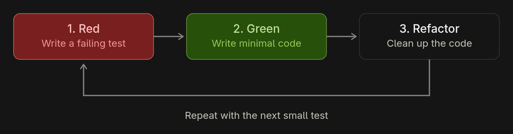

Here is a short study note on TDD from the article, starting with the core cycle as a diagram.



## What TDD is

TDD means you write the test before the code, in very small steps. The article's formula is **TDD = test-first development + refactoring**. Its main point is that the test works as a specification: writing it forces you to decide what the code should do before you write it.

## The steps

1. **Write one small test** for behaviour that doesn't exist yet.
2. **Run it and watch it fail.** This proves the test really checks something.
3. **Write just enough code** to make it pass, nothing extra.
4. **Run all the tests.** If anything fails, fix the code and rerun.
5. **Refactor.** Remove duplication and tidy the design while the tests stay green.
6. **Repeat** with the next test.

## Example (pytest)

Feature: an order total with a 10% discount at 1000 or more.

**Red: the test comes first, and fails because `order_total` doesn't exist.**
```python
# test_orders.py
from orders import order_total

def test_total_sums_item_prices():
    assert order_total([200, 300]) == 500
```

**Green: the smallest code that passes.**
```python
# orders.py
def order_total(prices):
    return sum(prices)
```

**Red again: the next behaviour.**
```python
def test_discount_applies_at_1000_or_more():
    assert order_total([600, 400]) == 900
```

**Green, then refactor: pass the test, then name the magic numbers.**
```python
DISCOUNT_THRESHOLD = 1000
DISCOUNT_RATE = 0.10

def order_total(prices):
    total = sum(prices)
    if total >= DISCOUNT_THRESHOLD:
        total -= total * DISCOUNT_RATE
    return total
```

## Two levels

| Level | Test describes | Typical tools |
|---|---|---|
| Acceptance TDD (also called BDD) | A requirement, from the user's view | Fitnesse, RSpec |
| Developer TDD | The design of one small piece of code | xUnit family (JUnit, PyUnit; pytest in Python) |

The ideal flow is one acceptance test first, then several developer-TDD cycles until it passes.

## What good tests look like

- They run fast.
- They run in isolation, so the order doesn't matter.
- They use data that is easy to read.
- Each one represents one small step toward the goal.

## Why it helps

- **Small steps make bugs easy to find.** A failure points at the few lines you just wrote.
- **Design improves.** Testable code tends to be loosely coupled and cohesive.
- **Tests become documentation.** They are working examples of how to call your code.
- **It scales.** The article cites a 4-year system with 250,000 lines of code and 4,000 tests running in under 20 minutes.

## Limits

- **It is not all your testing.** You still need integration, UI and exploratory testing.
- **100% coverage is not realistic.** Third-party code, UI and legacy parts are hard to cover.
- **It doesn't replace design thinking.** Sketch the architecture and requirements first, then use TDD for the build.
- **Slow suites need splitting.** Run a fast suite constantly and the full one in the background or on CI.
- **The whole team must agree to it.** It doesn't work if only some people do it.

## Applying it to your new project

1. Set up the test framework and a one-command test run before writing any feature code.
2. Sketch the overall design and data model lightly first.
3. For each feature, write one acceptance-level test (for example, an API endpoint test), then drive the internals with small unit tests.
4. Keep the fast suite under a few minutes and run the full suite in your CI pipeline on every push.
5. Agree on one rule with the team: no new function without a failing test first.